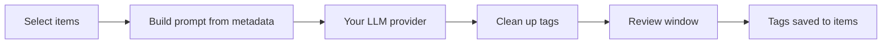

:lucide-tags:

# Your library, tagged. You approve every tag.

Autotag reads item metadata, asks the LLM you choose for tags, and shows them to you before anything is saved. A Tag Manager then merges the duplicates you already have.

[:lucide-download: Get Autotag](https://github.com/noahweidig/autotag/releases/latest){ .md-button .md-button--primary }
[:lucide-book-open: Install guide](install.md){ .md-button }
[:octicons-mark-github-16: GitHub](https://github.com/noahweidig/autotag){ .md-button }

  
<strong>7</strong><small>LLM providers</small>

  
<strong>8</strong><small>fields you choose to send</small>

  
<strong>1</strong><small>click to undo a merge</small>

  OpenAIAnthropic (Claude)Google GeminiDeepSeekOpenRouterCustom OpenAI-compatibleOllama (local)

- :lucide-tags:{ .lg .middle } **Tag selected items**

    ---

    Select items, right-click, **Autotag**. Titles, abstracts, authors and more go to your model; tags come back per item.

    [:lucide-arrow-right: Tag your items](usage.md)

- :lucide-list-checks:{ .lg .middle } **Review before applying**

    ---

    A review window lists the suggested tags for each paper. Edit, remove or add tags, then approve.

    [:lucide-arrow-right: The review window](usage.md#review-window)

- :lucide-merge:{ .lg .middle } **Tag Manager**

    ---

    Find duplicate tags across the whole library (case, plurals, typos, word order, abbreviations), rename, merge, delete in bulk, and undo each change.

    [:lucide-arrow-right: Tag Manager](tag-manager.md)

- :lucide-brush-cleaning:{ .lg .middle } **Tag cleanup rules**

    ---

    Strip slashes and symbols, merge duplicates, reuse the spelling of your existing tags, set case and separators, word and length limits, a blacklist and replacement rules. A live preview shows the result.

    [:lucide-arrow-right: Settings](settings.md#tag-cleanup)

- :lucide-plug:{ .lg .middle } **Bring your own model**

    ---

    OpenAI, Claude, Gemini, DeepSeek, OpenRouter, any OpenAI-compatible server (LM Studio, vLLM, Groq), or Ollama on your own machine.

    [:lucide-arrow-right: Providers](providers.md)

- :lucide-lock:{ .lg .middle } **Metadata only by default**

    ---

    PDFs and full text stay on your computer unless you switch on extracted PDF text. The Tag Manager's AI scan sends tag names only, in capped batches.

    [:lucide-arrow-right: Privacy](privacy.md)

## How a run works

Requires Zotero 7 or later on macOS, Windows or Linux, and an API key for a cloud provider (not needed for Ollama). Free and open source.
